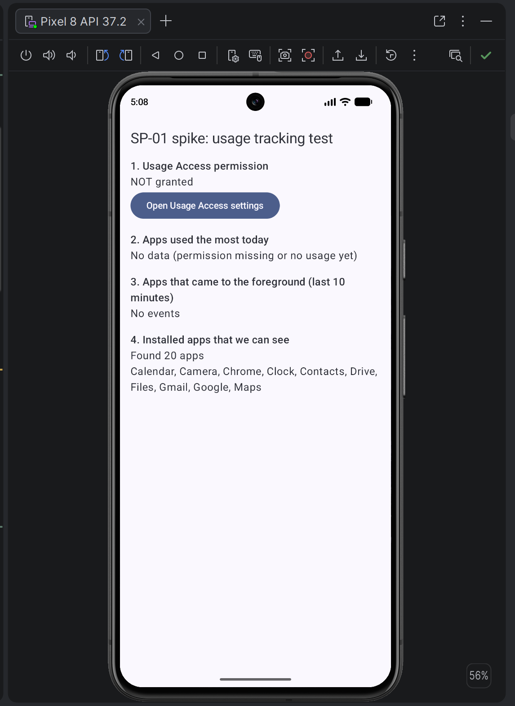
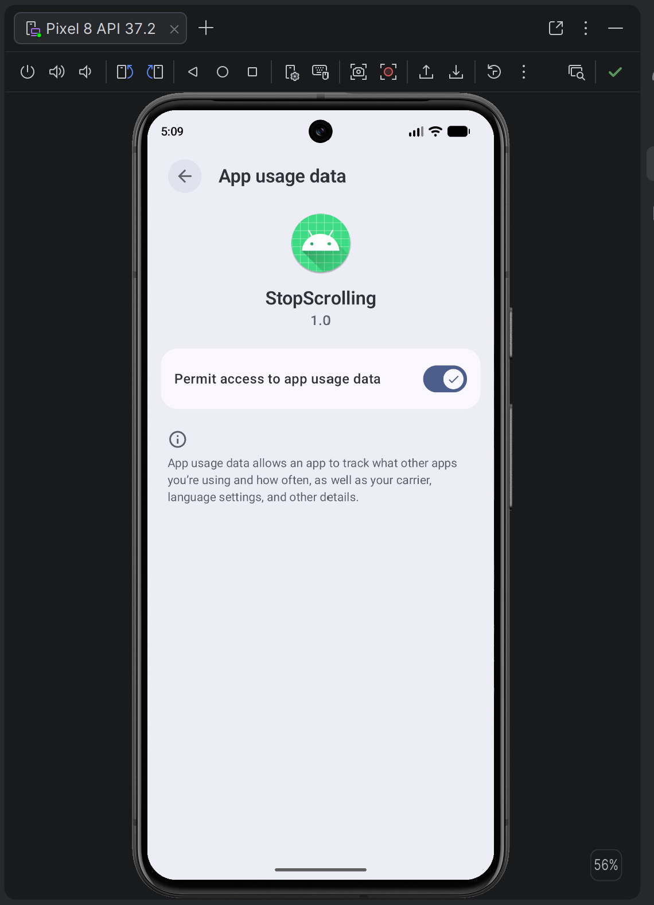
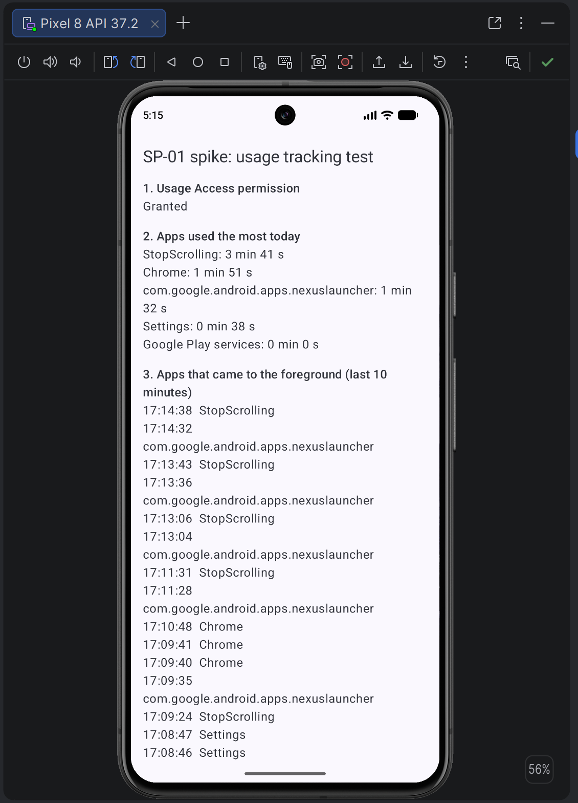
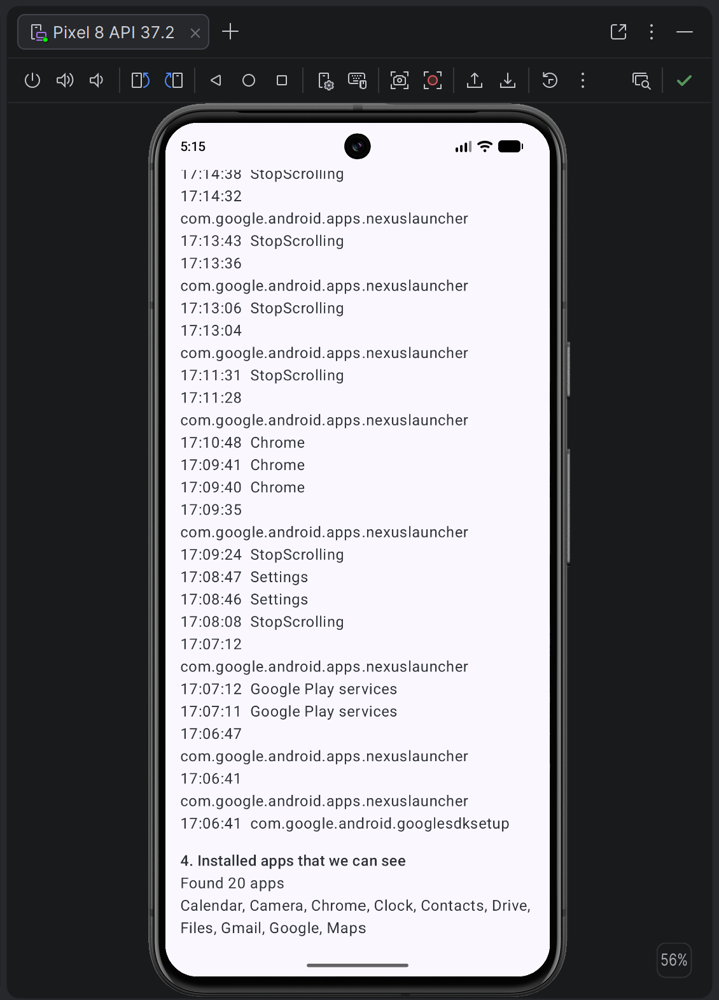
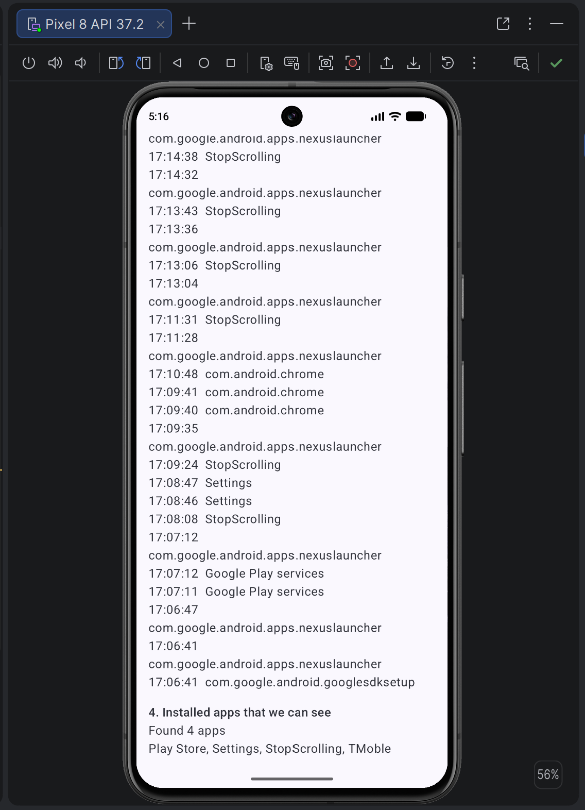

## Spike SP-01: Android usage tracking

**Time-box:** 6 hours. **Test code:** branch `spike/SP-01-usage-stats`.

**Goal:** find out if the main idea of StopScrolling (measure the time spent in apps and block them) is possible on Android.

### 1. Can we get the usage time per app?

**Yes.** `UsageStatsManager.queryAndAggregateUsageStats()` gives the time in the foreground of every app for a period of time. In the test we used "today".

- It needs the special permission **Usage Access** (`PACKAGE_USAGE_STATS`). This is not a normal permission dialog: the user must turn it on in the Android settings.
- We send the user to the settings screen with `Settings.ACTION_USAGE_ACCESS_SETTINGS`, and we check if the permission is granted with `AppOpsManager`.
- The user can turn the permission off at any time, so the app must check it every time it starts.

**Test result:** Pixel 8 Android 17.0 Chrome: 1 min 51 s



### 2. Can we detect the foreground app almost in real time?

**Yes, but only by checking again and again (polling).** `UsageStatsManager.queryEvents()` returns events with a time stamp, for example "this app came to the foreground". There is no callback: the app must ask every second or so.

- For the real feature we will need a **foreground service** (with a notification that the user can see) that checks the events about every second. A normal background task is not reliable for this.

**Test result:** The event was there at the same second.



### 3. How can we block an app?

Android has no simple "block this app" function for normal apps. These are the options we found:

| Option | How it works | Notes |
|---|---|---|
| **Foreground service + lock screen** | The service detects the app (question 2) and opens our own full-screen activity on top of it | Needs only Usage Access. Starting an activity from the background is restricted on recent Android versions, so it must be tested |
| **Overlay** | The service draws a view over the other app. Needs the permission "Display over other apps" (`SYSTEM_ALERT_WINDOW`) | The user gives the permission in the settings, like Usage Access |
| **Accessibility Service** | The system tells the service every time a window changes | Fast, but the user must enable it, it is a heavier permission, and Google Play limits this use |

**Our choice for the project:** foreground service that checks the foreground app, and our own lock screen or an overlay on top of the app. We will test it in Sprint 2 (stories US-10, US-11 and the hard limits).

**Limit:** the user can always turn off Usage Access or stop the service, so the block is not impossible to avoid. This is OK for our project, because the user installs the app to help themself.

### 4. Which permissions do we need to list all the installed apps?

**No special permission, only a `<queries>` element.** From Android 11 an app only sees a filtered list of the other apps. We declare in `AndroidManifest.xml` that we want the apps with a launcher icon:

```xml
<queries>
    <intent>
        <action android:name="android.intent.action.MAIN" />
        <category android:name="android.intent.category.LAUNCHER" />
    </intent>
</queries>
```

- We do **not** need `QUERY_ALL_PACKAGES`. Google Play restricts that permission, and `<queries>` is enough for us.

**Test result:** Number of apps found with and without the `<queries>` element: 20 with, 4 without.



### Effects on the backlog

- The main idea is possible, so the stories about usage tracking and blocking stay in the backlog.
- The background monitoring needs a foreground service with a notification. We will add this to the story that does the monitoring.
- The Usage Access permission is the first thing the user must do, so US-02 is important. The app must also handle the case when the user turns it off later.

