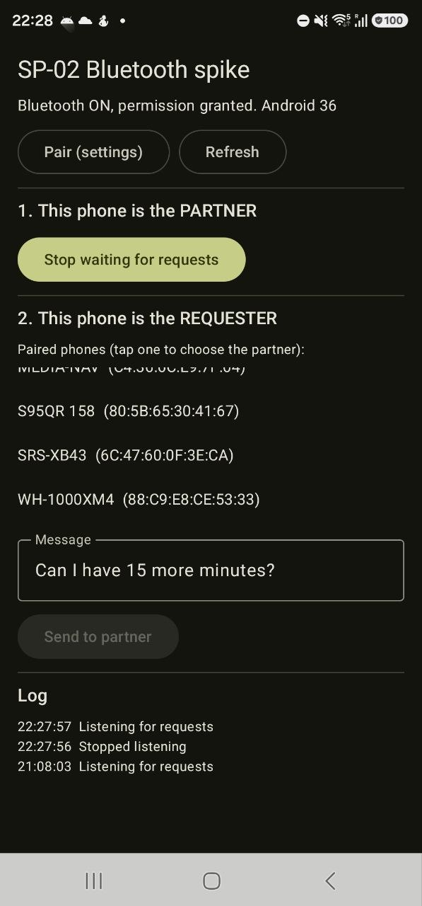
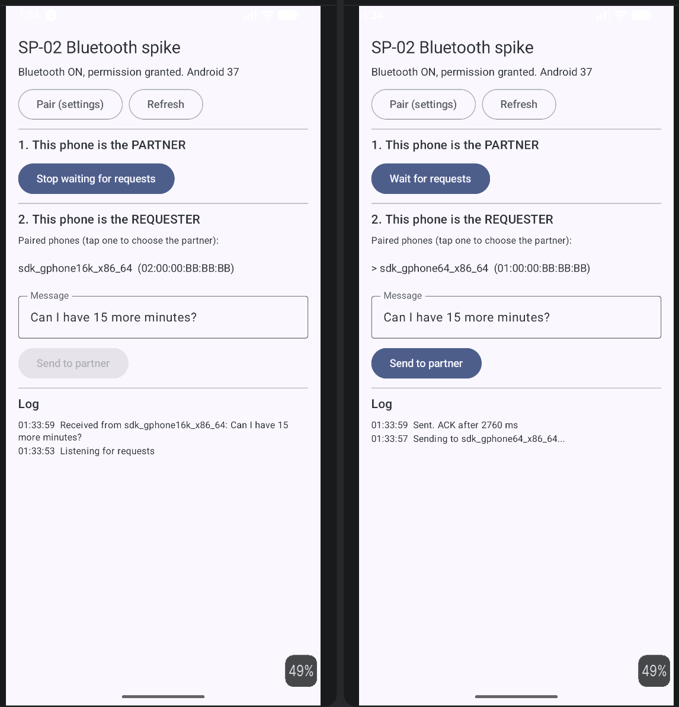
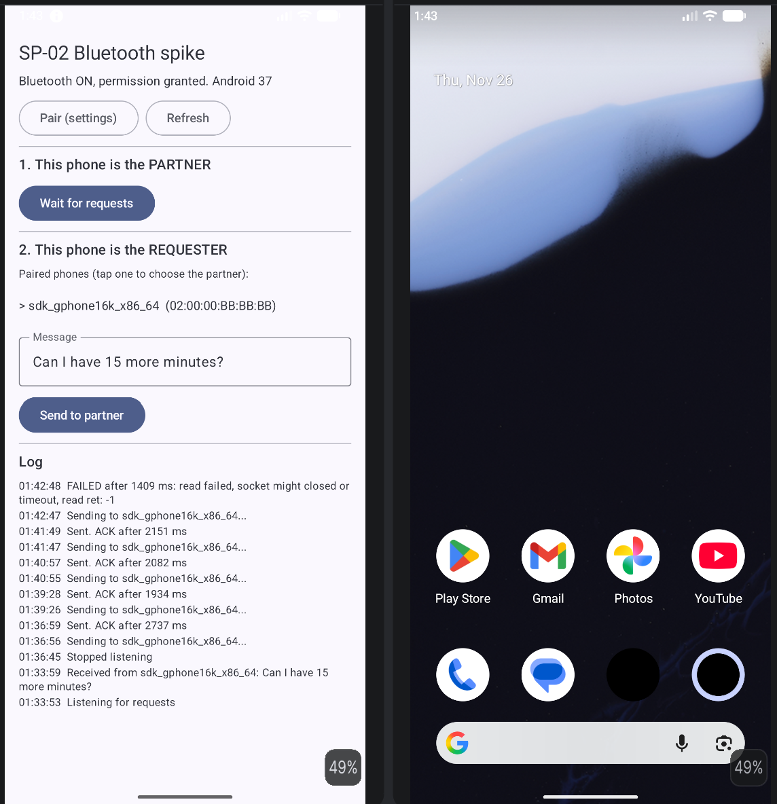

## Spike SP-02: Bluetooth messages between two phones

**Time-box:** 6 hours. **Test code:** branch `spike/SP-02-bluetooth` (second icon "BT Spike" on the phone).

**Goal:** find out if a phone can send a short request ("Can I have 15 more minutes?") to the phone of an accountability partner in the same room, and if the partner phone can show it as a notification, even when the app is in the background. This is the base of the stories US-23 to US-26.

**Test phones:** Two emulators on Android Studio with Android API 37.2, and also a single Samsung Galaxy S23 Ultra (Android 16)

### 1. Which technology do we choose?

| Option | How it works | Good | Limits |
|---|---|---|---|
| **Classic Bluetooth (RFCOMM)** | The partner phone waits on a Bluetooth socket. The other phone connects to it and sends a line of text. | No library, no Google Play services. The pairing is done by Android, so the partner is "trusted" without our own code. The partner does not need to advertise all the time. | The phones must be paired first. The app process of the partner must be alive. |
| **Bluetooth Low Energy (BLE)** | The partner phone advertises and runs a GATT server. The other phone scans, connects and writes a value. | Low battery use. | More code (advertising, GATT server, messages cut in small parts). We have to handle the pairing and the trust ourselves. |
| **Nearby Connections** | A Google Play services library that finds the other phone and opens an encrypted connection. | Very little code. It gives a short code to compare on both phones. | Needs Google Play services. The partner must advertise all the time to be found. We still need our own way to remember the trusted partner. Not tested by us. |

**Our choice for the project:** Classic Bluetooth (RFCOMM) with the pairing of Android. In the test, the partner phone runs a foreground service with a Bluetooth server socket, and the other phone sends one line of text and waits for the answer `ACK`.

**Test result:** Message arrived, 2760 ms between message sent and ACK one way, and 2737 ms the other way. Probably slower than it would really be on real phones.

### 2. Can the receiving phone detect requests while the app is in the background?

**Yes, if the app runs a foreground service.** The Android documentation says that Bluetooth APIs can be used when the app is not visible, but the process of the app must be alive, and a connection closes if the process is killed. For a long task, the app uses a foreground service of the type `connectedDevice`. Android 12 and higher restricts starting a foreground service from the background, so the service must be started while the app is visible (the user starts the monitoring in the app).

- StopScrolling already runs a foreground service (`UsageMonitorService`). The Bluetooth server can be added to it later, or run in a second service. The type `connectedDevice` needs the Bluetooth runtime permission to be granted before the service starts (Android 14 and higher).
- The partner shows a notification when a message arrives (permission `POST_NOTIFICATIONS` on Android 13 and higher).

**Test result:** 

| Case on the partner phone | Notification? |
|---|---|
| The app is in the background (home screen) | yes |
| The screen is off for 5 minutes | yes |
| The app was removed from the recent apps list | yes |
| The app was force stopped in the settings (we expect: no) | no |

### 3. Which permissions are required, and from which Android version?

| Permission | Android versions | Why |
|---|---|---|
| `BLUETOOTH` | up to 11 (API 30), normal permission, no dialog | Connect, listen, use the paired devices |
| `BLUETOOTH_CONNECT` | 12 and higher (API 31), runtime permission | Use the paired devices, listen and connect |
| `POST_NOTIFICATIONS` | 13 and higher (API 33), runtime permission | Show the notification of a request |
| `FOREGROUND_SERVICE_CONNECTED_DEVICE` | 14 and higher (API 34), normal permission | Foreground service of the type `connectedDevice` |

- **We do not need the location** and we do not need `BLUETOOTH_SCAN` in this design, because the phones are paired in the Android settings and the app does not search for devices.
- If we later search for devices inside the app (US-26), Android 12 and higher also needs `BLUETOOTH_SCAN`, and `BLUETOOTH_ADVERTISE` to make the phone visible. Android 11 and lower needs the location permission for the search.
- For Nearby Connections, the official list is longer (Wi-Fi permissions, `NEARBY_WIFI_DEVICES`, and the location on Android 10 to 12). We did not choose it.
- Android 17 adds the permission `ACCESS_LOCAL_NETWORK` for the local Wi-Fi network. It is not needed for Classic Bluetooth.

**Test result:** Usual permissions were asked, but also "find, connect to, and determine the relative position of nearby devices".

### 4. How can two phones pair and recognize each other as trusted?

**With the pairing of Android (bonding).** The two phones are paired once in the Bluetooth settings (our button "Pair (settings)" opens them). Android shows a code on both phones that the users compare, and then keeps a key for the pairing. After that, the connection is encrypted and Android knows the other phone.

- In the app, the trusted partner is a paired phone that the user selects. We save its Bluetooth address in the database.
- The server socket is "secure": if the phones are not paired, Android asks for the pairing when the connection starts.
- Android 17 can pair again by itself when a pairing is lost.

**Limit:** Android only knows that the phone is paired, not that it is the right person. If someone changes the partner phone, the user must select the new partner again.

**Test result:** Both phone showed the same 6 digits code, and there was no need to pair again after restarting the app.

### 5. What is our story point estimate for US-23 to US-26?

This is a first estimate. The team confirms it with Planning Poker.

| Story | Backlog | New estimate | What the work is |
|---|---|---|---|
| US-26 Pair with a partner | 13 | 8 | Screen to open the Bluetooth settings, list the paired phones, save one partner in Room. 13 if we also search and pair inside the app. |
| US-23 Send a request | 13 | 8 | Request and answer messages, wait for the decision with a time limit, errors (partner not found, no answer), give the extension after "approved". |
| US-24 Receive a request | 8 | 5 | Run the server in a foreground service, notification, permissions, restart of the service. |
| US-25 Approve or deny from the notification | 5 | 5 | Notification buttons, a receiver, and sending the answer on the open connection. |
| **Total** | **39** | **26** | |

We could lower the story points, but there are still things that are uncertain, so it's probably better to keep the old estimates.

### Effects on the backlog

- The feature is possible with Classic Bluetooth, so US-23 to US-26 stay in the backlog with same estimates.
- The partner needs a service that runs all the time. We must say it clearly to the user, because it has a cost for the battery.
- If the partner app is not running, the request fails. The requester must see a clear message and can use another way to get more time (for example the math challenge).
- PC-01 (README) must explain how to pair two phones: open the Bluetooth settings, pair, then select the partner in the app.
